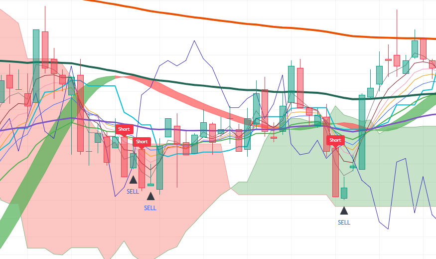

# Pine-Script-Use-Method-Ver.2
Refined indicator based on multi-timeframe EMAs, dual-timeframe MACD, RSI alignment, Ichimoku, and Hull Suite with a modular "Use" toggle architecture. Signals entry for long/short in futures for any cryptocurrency on Trading View.

--

## Chart Preview

--

## Motivation & Problem

- **Strategy Bloat & Rigid Execution**: In previous iterations, excessive overlapping conditions caused signal lag and over-filtering, while the inability to easily disable sub-filters made testing difficult across different market conditions.
- **The Core Goal**: To build a cleaner, second-generation strategy engine (V2) that improves signal precision using dual-timeframe MACD confluence, streamlined EMA 30 crossover triggers, and the modular "Use" toggle feature to dynamically switch filters on or off.

--

## Strategy Logic & Architecture

- This indicator avoids false signals and wrong interpretation of the trend by utilizing a **rule-based, multi-factor filtering system**:

### Core Components:
1. **Trend & Ribbon Filters (EMA, Hull Suite, Time Mark)**:
  - Uses a 10-period EMA ribbon on the 3-minute timeframe to detect momentum crossovers (fast EMAs 3, 5, 7, 9 crossing the 30 EMA).
  - Plots 1-hour and 1-day opening price levels dynamically on the chart as key intraday support and resistance reference points.
  - Hull Suite band and Ichimoku conversion line slope provide optional higher-level trend confirmation.

2. **Dual-Timeframe MACD & The "Use" Feature**:
  - Evaluates both the 1-minute Signal line and 2-minute MACD line against the zero line simultaneously for reliable momentum confirmation.
  - Integrates the "Use" toggle feature (UseEMA1to10, UseRSI, UseMACD, UseIchimoku, UseHullSuite), allowing traders to turn any individual technical filter on or off directly from the user interface.

3. **Execution Rule**
  - **Bullish Signal**: Triggers when fast EMAs cross above the 30 EMA (if enabled) and multi-period RSIs are sorted and above 55 (if enabled) and both 1m Signal and 2m MACD lines are above zero (if enabled) and Ichimoku conversion line slopes up (if enabled) and price is above Hull Suite (if enabled) in a 3-minute timeframe.
  - **Bearish Signal**: Triggers when fast EMAs cross below the 30 EMA (if enabled) and multi-period RSIs are sorted and below 45 (if enabled) and both 1m Signal and 2m MACD lines are below zero (if enabled) and Ichimoku conversion line slopes down (if enabled) and price is below Hull Suite (if enabled) in a 3-minute timeframe.

--

## Configurable Parameters

Users can adjust the following parameters inside TradingView's settings panel:

- **Use Feature Toggles**: Default - EMA (true), RSI (true), MACD (true), Ichimoku (false), Hull Suite (false). Toggles individual indicator filters on or off dynamically.
- **EMA Length**: Default - 3, 5, 7, 9, 12, 20, 30, 60, 100, 200. Lookback period for the 3-minute EMA ribbon.
- **RSI Time Frame & Length**: Default - 3m timeframe, lengths 7, 9, 12. Lookback periods for RSI confirmation.
- **MACD Time Frames**: Default - 1m and 2m. Lookback timeframes for dual-timeframe MACD confirmation.
- **Conversion Line Length**: Default - 9. Lookback period for Ichimoku conversion line.
- **Hull Suite**: Default - HMA length 55, 240m HTF. Trend band configuration.

--

## How to Install & Use in TradingView

1. Open any crypto chart (e.g., `BTC/USDT`) on **[TradingView](https://www.tradingview.com/)**.
2. Open the **`Pine Editor`** console at the bottom of the page.
3. Open `indicator.pine` from this repository, copy the source code, and paste it into the editor.
4. Click **`Save`** and then click **`Add to Chart`**.
5. Click the gear icon (`Settings`) on the indicator to adjust parameters as needed.

--

## Key Learnings & Engineering Reflections

1. **Modular Filter Control Using the Ternary Operator (x ? y : true)** 
  - I learned that using the ternary operator (x ? y : true) (e.g., (UseMACD ? macdLong : true)) enables clean conditional branching. If toggle x is active, condition y must be satisfied; if x is false, it returns true as a pass-through bypass, making the indicator modular and testable without altering code.
2. **Dual-Timeframe MACD Momentum Confluence**
   - I learned that evaluating the Signal line on a 1-minute timeframe alongside the MACD line on a 2-minute timeframe against the zero line provides cleaner, earlier momentum confirmation than a single timeframe, filtering out noisy micro-fluctuations.
